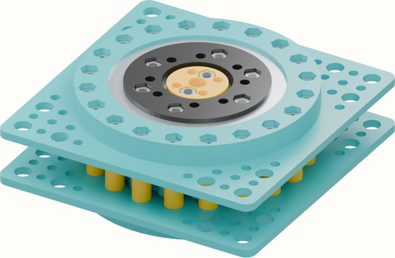

# OOBB cycloidal gearbox

Hold the black inner carrier fixed and drive the centre shaft. The ratio gives the number of input turns for one turn of the turquoise outer casing. Each ratio uses two opposed cycloids, square OOBB flanges and 6810 casing bearings.

| Reduction | CAD and code | Print kit | Build notes | Assembly viewer | Booklet | Hardware |
| --- | --- | --- | --- | --- | --- | --- |
| **20:1** | [SolidCraft](parts/oobb_part_motor_gearbox_cycloidal_version_11_20_to_1_reduction/gearbox_controls.solidcraft) · [Populate code](working_oomp_populate.py) | [4-plate 3MF](parts/oobb_part_motor_gearbox_cycloidal_version_11_20_to_1_reduction/working.3mf) | [Illustrated guide](parts/oobb_part_motor_gearbox_cycloidal_version_11_20_to_1_reduction/README.md#assembly) | [Open viewer](https://oomlout.github.io/oomlout_oobb_part_motor_gearbox_cycloidal_version_5/20-to-1/) | [PDF](parts/oobb_part_motor_gearbox_cycloidal_version_11_20_to_1_reduction/assembly/assembly_instructions.pdf) | [BOM](parts/oobb_part_motor_gearbox_cycloidal_version_11_20_to_1_reduction/assembly/parts.csv) |
| **30:1** | [SolidCraft](parts/oobb_part_motor_gearbox_cycloidal_version_11_30_to_1_reduction/gearbox_controls.solidcraft) · [Populate code](working_oomp_populate.py) | [4-plate 3MF](parts/oobb_part_motor_gearbox_cycloidal_version_11_30_to_1_reduction/working.3mf) | [Illustrated guide](parts/oobb_part_motor_gearbox_cycloidal_version_11_30_to_1_reduction/README.md#assembly) | [Open viewer](https://oomlout.github.io/oomlout_oobb_part_motor_gearbox_cycloidal_version_5/30-to-1/) | [PDF](parts/oobb_part_motor_gearbox_cycloidal_version_11_30_to_1_reduction/assembly/assembly_instructions.pdf) | [BOM](parts/oobb_part_motor_gearbox_cycloidal_version_11_30_to_1_reduction/assembly/parts.csv) |

## Regenerate

Add the integer reduction to `RATIOS` in the [populate definition](working_oomp_populate.py). Run `python action_make_all.py` from the repository root to build each editable preset, export and check its geometry, and regenerate its print kit, guide and table row. The [shared native master](version_11.solidcraft) contains the design. Above 20:1, eccentricity is 30 mm divided by the reduction so both presets can use the same casing diameter and sleeve size. The build checks the resulting profile, assembly paths and print plates.

The [build entry point](action_make_all.py) uses the configured SolidCraft Python environment, Blender and Bambu Studio.

This is an entirely AI-generated coding project. The source code is largely unreadable by humans, but usable generated files are included. It is published so others can use their own AI tools to understand, modify and regenerate the design.

> AI-generated CAD images and instructions. Errors possible.
