# Manual 20:1 cycloidal gearbox

## Summary

A 3D-printable cycloidal gearbox for OOBB mechanisms. Drive the centre shaft and hold the inner carrier fixed to turn the outer casing once per 20 input turns.

> AI-generated CAD images and instructions. Errors possible.

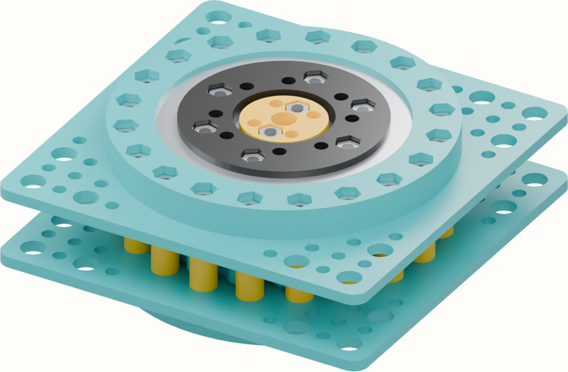

## Details

The two cycloids each have 19 lobes and run on opposed cams with 1.5 mm eccentricity. The turquoise casing carries 20 contacts. Fixing the casing instead gives a 19:1 output at the black carrier, opposite the input.

Print each plate of the [editable P1S kit](working.3mf) once. It contains 48 printed pieces for the square-flange build, including 20 loose contact sleeves. The [print guide](PRINT_KIT.md) lists the plate colours and the alternative flanges and contact ring.

[Editable SolidCraft preset](gearbox_controls.solidcraft) · [Shared source master](../../version_11.solidcraft) · [Assembled CAD](true.solidcraft) · [Exploded CAD](exploded.solidcraft) · [Full print layout](3dpr.scad) · [Individual STLs](native_parts/)

Edit the shared master to change all gearboxes. Run `python action_make_all.py` to regenerate the populated ratios. Run `python working.py --assembly-only` to rebuild these instructions from the verified export.

## Parts

[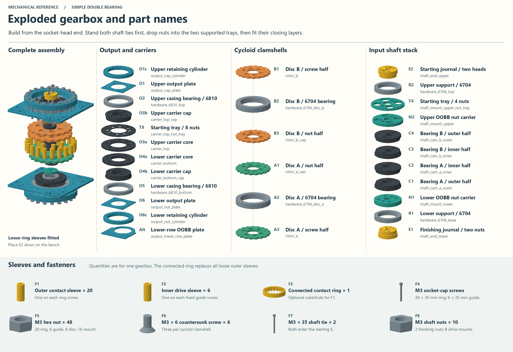](exploded_labeled.png)

Hardware for one square-flange gearbox with all mounting pockets populated. External frame, drive and load fasteners depend on the installation.

| Hardware | Size or use | Quantity | OOMP code |
| --- | --- | ---: | --- |
| [6810 bearing](https://github.com/oomlout/oomlout_oomp_version_1_messy/tree/main/parts/hardware_bearing_6800_series_6810_size_50_mm_id_65_mm_od_7_mm_depth) | 50 × 65 × 7 mm, one at each end | 2 | [7xku1](https://oom.lt/a/7xku1) |
| [6704 bearing](https://github.com/oomlout/oomlout_oomp_version_1_messy/tree/main/parts/hardware_bearing_6700_series_6704_size_20_mm_id_27_mm_od_4_mm_depth) | 20 × 27 × 4 mm, two shaft and two disc bearings | 4 | [4y780](https://oom.lt/a/4y780) |
| [M3 x 30 socket-cap screw](https://github.com/oomlout/oomp_hardware_screw_version_5/tree/main/parts/hardware_screw_socket_cap_hex_head_black_m3_diameter_30_mm_length) | 20 casing contacts | 20 | [4x6wf](https://oom.lt/a/4x6wf) |
| [M3 x 35 socket-cap screw](https://github.com/oomlout/oomp_hardware_screw_version_5/tree/main/parts/hardware_screw_socket_cap_hex_head_black_m3_diameter_35_mm_length) | Six guides and two shaft ties | 8 | [22vya](https://oom.lt/a/22vya) |
| [M3 x 6 countersunk screw](https://github.com/oomlout/oomp_hardware_screw_version_5/tree/main/parts/hardware_screw_countersunk_hex_head_black_m3_diameter_6_mm_length) | Three per cycloid | 6 | [61zh8](https://oom.lt/a/61zh8) |
| [M3 hex nut](https://github.com/oomlout/oomlout_oomp_version_1_messy/tree/main/parts/hardware_nut_m3) | 20 casing, 6 guides, 2 ties, 6 disc clamps and 24 mounting nuts | 58 | [3vb5b](https://oom.lt/a/3vb5b) |

[Complete printed and hardware inventory](assembly/parts.csv)

## Assembly

[Open the assembly viewer](https://oomlout.github.io/oomlout_oobb_part_motor_gearbox_cycloidal_version_5/20-to-1/) · [Download the offline viewer (ZIP)](https://oomlout.github.io/oomlout_oobb_part_motor_gearbox_cycloidal_version_5/20-to-1/downloads/assembly-viewer.zip) · [Download the landscape A4 booklet](assembly/assembly_instructions.pdf)

Open the downloaded HTML file in a browser for offline use. The viewer starts at steps 1–4. Print the PDF at actual size, using booklet imposition only once if folding it.

Prepare a 2.5 mm hex key for the socket caps and a 2 mm key for the countersunk screws. Lay out the A and B cam pairs separately. The drawings show the native upper end on the bench, with the shaft screws pointing up.

1. **Set down the socket end.** Place the socket-side cylinder, black carrier cap and yellow two-socket journal flange-down on a support with access underneath. The native model calls this end “upper”.

    [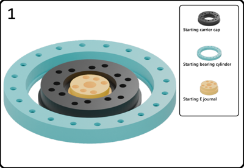](assembly/cards/step_01.png)

2. **Stand all 28 screws.** Insert 20 M3 × 30 socket caps through the outer ring, six M3 × 35 through the carrier and two M3 × 35 through the yellow journal. Both shaft screw heads sit at this end. Support the heads while building upward.

    [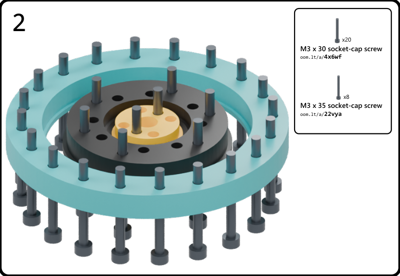](assembly/cards/step_02.png)

3. **Seat the first two bearings.** Lower the 6810 over the black journal and the centred 6704 over the yellow journal. Seat both flat on their shoulders.

    [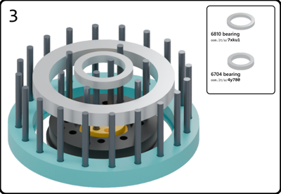](assembly/cards/step_03.png)

4. **Place the empty nut trays.** Lower the square socket-side plate. Slide the large black eight-pocket tray and small turquoise four-pocket tray over the standing screws, with both sets of pockets open upward.

    [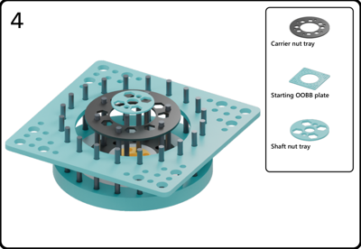](assembly/cards/step_04.png)

5. **Load the twelve mounting nuts.** Drop eight M3 nuts into the black tray and four into the turquoise tray. Seat the flats in their pockets while the screw heads remain supported.

    [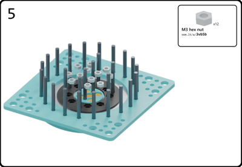](assembly/cards/step_05.png)

6. **Close both trays.** Lower the socket-end carrier core over the eight outer nuts and the small shaft nut carrier over the four inner nuts. Both covers should settle flat.

    [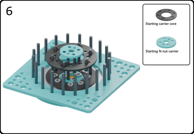](assembly/cards/step_06.png)

7. **Add the sleeves.** Slide 20 yellow contact sleeves onto the ring screws and six yellow guide sleeves onto the inner screws. Seat the six guides in the carrier sockets.

    [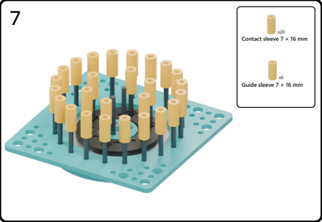](assembly/cards/step_07.png)

8. **Start cam B.** Slide the B outer cam onto the two shaft screws with its narrow eccentric journal facing up.

    [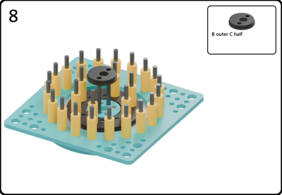](assembly/cards/step_08.png)

9. **Prepare disc B.** On the bench, seat one 6704 between the B screw half and the B nut half. Match the three clamp holes before closing the halves.

    [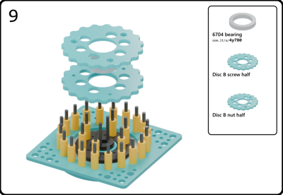](assembly/cards/step_09.png)

10. **Clamp disc B.** Fit three M3 nuts and three M3 × 6 countersunk screws. Seat the heads flush. Orient the closed disc with the screw heads facing down for installation.

    [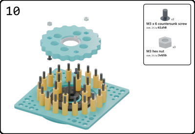](assembly/cards/step_10.png)

11. **Install B and oppose the cams.** Lower the closed B disc over all six guide sleeves and onto the B journal. Point its indexed clamp screw toward the wide guide gap. Add B inner cam journal-down, then A inner cam journal-up. Their eccentric offsets face opposite ways.

    [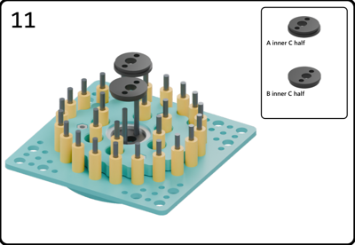](assembly/cards/step_11.png)

12. **Prepare disc A.** Seat a 6704 bearing between the two A disc halves. Orient the A screw half upward and align all three clamp holes.

    [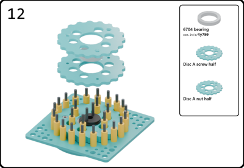](assembly/cards/step_12.png)

13. **Clamp disc A.** Fit three M3 nuts and three M3 × 6 countersunk screws. Seat the heads flush with the upward-facing screw half.

    [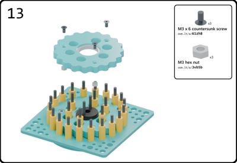](assembly/cards/step_13.png)

14. **Install A and close its cam.** Lower disc A onto the six guides and the A journal with the indexed clamp screw toward the same wide gap. Fit the A outer cam journal-down.

    [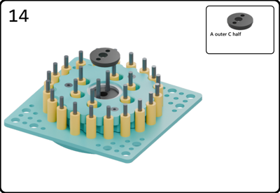](assembly/cards/step_14.png)

15. **Fit the finishing plate and carriers.** Lower the nut-side square plate, carrier core and shaft nut carrier. Seat the six guide sleeves in the matching recesses. Keep both sets of mounting pockets facing up.

    [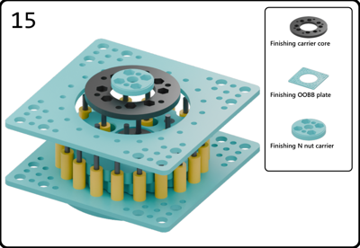](assembly/cards/step_15.png)

16. **Load the finishing nuts.** Seat eight M3 mounting nuts in the black core and four in the turquoise shaft nut carrier before fitting the bearings and caps.

    [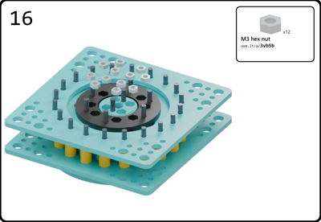](assembly/cards/step_16.png)

17. **Seat the second pair of bearings.** Lower the second 6810 onto the casing and carrier seat. Lower the remaining centred 6704 onto the shaft nut carrier.

    [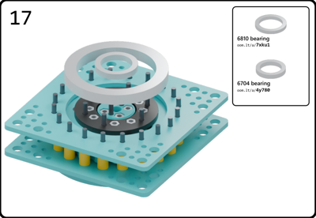](assembly/cards/step_17.png)

18. **Close the nut end.** Lower the nut-side cylinder, black carrier cap and yellow two-hex-pocket end journal. Check that the two shaft screw tips reach the yellow hex pockets.

    [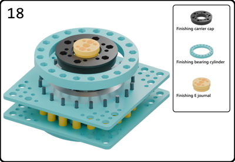](assembly/cards/step_18.png)

19. **Secure and turn the gearbox.** Start both shaft-tie nuts, the six guide nuts and the 20 ring nuts. Snug each group evenly, turning the shaft by hand between groups. For 20:1, mount the black inner carrier to the frame, drive the yellow centre and attach the load to the turquoise outer casing.

    [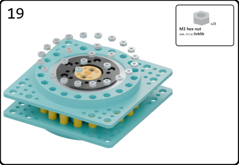](assembly/cards/step_19.png)

The assembly sequence and nut access have been checked in CAD. Physical fit and load capacity remain unverified.
