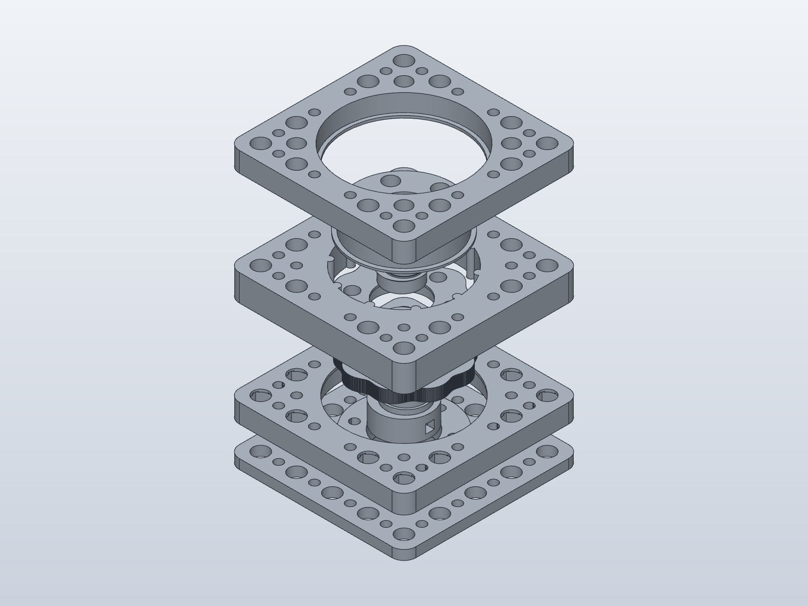

# Native V9 — 10:1

Edit [gearbox_controls.solidcraft](gearbox_controls.solidcraft) in SolidCraft's
Parameters menu. [Editing instructions](EDITING_PARAMETERS.md) explain the
controls and print orientations. This preset uses the same feature graph as
the other V9 presets, with exposed parameter overrides only.

| Dimension | Value |
|---|---:|
| Contact radius | 1.5 mm |
| Eccentricity | 0.9 mm |
| Casing bearing | 6808 |
| Minimum circular casing envelope | 56.2 mm |
| OOBB grid | 5 × 5 |
| Tab footprint | 74 × 74 mm |
| Guide screws | 6 × M3 × 25 mm |
| Casing joining screws | 4 × M3 socket cap × 20 mm |

[Assembled](true.solidcraft) · [Exploded](exploded.solidcraft) ·
[Print layout](3dpr.solidcraft) · [Print STL](3dpr.stl)

Individual print-oriented STEP/STL files are in `native_parts/`. The three
casing pieces print separately on their flat split/end faces. These view files
are independent snapshots. Native geometry and hardware clearance have been
checked; physical printing and load testing are still needed.

[Hardware for this published preset](HARDWARE.md)
