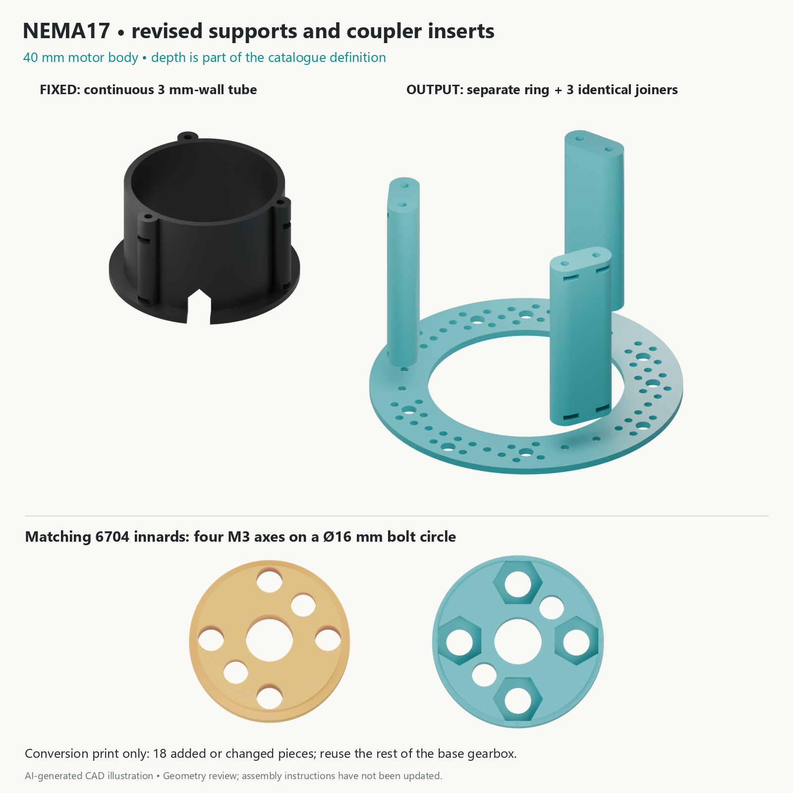

# NEMA17 conversion — 40 mm motor body

Geometry review revision: three identical, separate teal joiners, spaced 120 degrees apart, plus a
continuous 3 mm-wall black motor support tube with a peaked cable opening.
Each joiner uses two M3 x 10 countersunk screws at each end. The rear ring is a separate flat print. The matching output
plates now have six extension screw/access holes. Joining screws remain short.

This is an entirely AI-generated coding project. The generated files are
included as a starting point for modifications with your own AI tools.

- [Conversion print](nema3dpr.scad): 18 extra or changed parts, arranged on three beds.
- [Bed 1](motor_conversion/bed_1/3dpr.scad) · [Bed 2](motor_conversion/bed_2/3dpr.scad) · [Bed 3](motor_conversion/bed_3/3dpr.scad)
- [Exact print inventory](motor_conversion/conversion_inventory.json)
- [Native parameter model](gearbox_controls.solidcraft)
- [Parameter editing](EDITING_PARAMETERS.md)
- [Native conversion-only print view](3dpr.solidcraft)
- [Individual parts](native_parts/)

The base gearbox's discs, cams, sleeves and unchanged bearing carriers are
reused. The two circular output plates replace the base plates. Optional square
and asymmetric replacements are in native_parts; print one matching pair.

The motor-side 6704 journal and nut carrier are **different from the base
gearbox**. Their four M3 axes lie on a **16 mm bolt circle**, radius 8 mm.
Print `coupler_6704_journal.stl` and `coupler_6704_nut_carrier.stl` when selecting
individual files. These are named copies of `shaft_end_lower` and
`shaft_mount_lower`, already included once each in the conversion print.
Do not print both aliases and original names.

`rear_output_joiner.stl` is the common joiner: print three. The conversion bed
already contains those three copies. `rear_output_ring.stl` is its separate
3 mm rear ring. Twelve M3 x 10 countersunk screws and twelve M3 nuts attach
the joiners, six at the gearbox end and six at the rear ring.

The 6810 socket-side cap is included because it has the overhang bridges absent
from the preserved manual base. Its mating nut-side cap is reused.

`motor_depth` is the motor body length, excluding the shaft. The current part
definition uses 40 mm and includes that depth in its ID.
Edit the same setting in populate to create another depth in a separate folder,
or edit the native favourite to resize the current model. `motor_tube_wall`
and `coupler_bolt_circle_diameter` are also exposed native parameters.

[Full illustrated assembly guide](assembly_guide/README.md) · [Printable PDF](assembly_guide/assembly-guide.pdf) · [Hardware table](assembly_guide/hardware.csv)

The guide covers all 23 stages from the base gearbox through the 40 mm NEMA17 conversion, including nut-loading and tool access. The insertion sequence is CAD checked; this revision has not been physically test assembled.
