# NEMA17 gearbox assembly - 40 mm motor body

AI-generated images and instructions. Errors possible.

[Printable illustrated PDF](assembly-guide.pdf) | [Hardware CSV](hardware.csv) | [Printed inventory CSV](printed-parts.csv)

Use the current 40 mm-depth conversion print plus the unchanged base gearbox parts. The conversion print contains 18 extra or replacement pieces, not a complete second gearbox. The illustrated circular-plate assembly contains 59 printed pieces with loose outer contacts. A connected outer ring replaces twenty loose contacts; do not install both.

**Configuration:** 20:1 rotating outer casing; 40 mm motor; 1.5 mm eccentricity; 7 mm split discs; 16 mm sleeves; two 6810 and four 6704 bearings. Both black covers remain fixed.

## Before you start

Front means the fixed black cover opposite the motor. Rear means the motor end. Build the core front-face down on an open support: native top/upper parts go in first and native bottom/lower parts go in last. Turn the assembly as needed after closing the core. In the illustrations, incoming layers are separated to show their order; those display gaps are not assembly dimensions.

Use a 2.5 mm hex key for M3 socket caps, a straight 2 mm hex key for countersunk screws, the coupler's matching grub key, tweezers for nuts, and an open support that leaves at least 50 mm access beneath the front face. Check actual screw heads against your tools. Clean print bridges and test-fit each bearing and nut before stacking.

Keep screws loose until each layer is seated, then snug them evenly. If turning gets tight, loosen the last fasteners and reseat the layer. Do not use a screw to pull an unseated bearing into place.

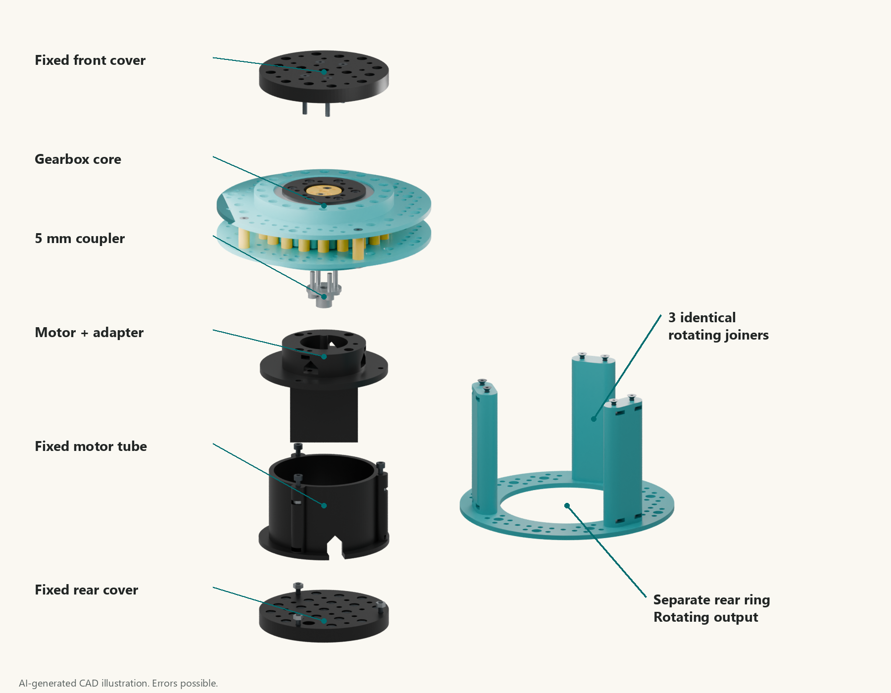

## Printed inventory

Use [nema3dpr.scad](../nema3dpr.scad) for the conversion-only kit and the base gearbox prints for reused parts. Current individual files are in [native_parts](../native_parts/). Use the conversion versions of `carrier_top_cap`, `shaft_end_lower`, `shaft_mount_lower` and both circular output plates. The coupler aliases duplicate E/N: do not print them twice.

| Part group | Qty | Native names / size |
|---|---:|---|
| Circular output plates | 2 | output_circle_plate; output_circle_rear_plate |
| 6810 bearing cylinders | 2 | output_cap_cylinder; output_nut_cylinder |
| 6810 inner carrier halves | 4 | carrier_top; carrier_top_cap; carrier_bottom; carrier_bottom_cap |
| Centred shaft ends E | 2 | shaft_end_upper; shaft_end_lower (modified for coupler) |
| Centred shaft nut carriers N | 2 | shaft_mount_upper; shaft_mount_lower (modified for coupler) |
| Eccentric cam halves | 4 | shaft_cam_a_inner/outer; shaft_cam_b_inner/outer |
| Cycloid halves | 4 | rotor_a; rotor_a_cap; rotor_b; rotor_b_cap |
| Outer contact sleeves | 20 | printed_contact_sleeve; OD 7 x 16 mm |
| Inner guide sleeves | 6 | printed_drive_sleeve; OD 7 x 16 mm |
| Motor adapter and tube | 2 | motor_inner_adapter; motor_cage |
| Fixed front cover pieces | 3 | front_cover_spacer; front_cover_nuts; front_cover_face |
| Fixed rear cover pieces | 2 | rear_cover_nuts; rear_cover_face |
| Identical teal joiners | 3 | rear_output_joiner_1/2/3; common alias rear_output_joiner |
| Rear output ring | 1 | rear_output_extension; alias rear_output_ring |
| Extra plate braces | 2 | rear_output_spacer_1/2; OD 7 x 16 mm |

## Hardware

Quantities include all captive mounting nuts. External frame/load fasteners are excluded. Optional unused mounting pockets may be left empty; leave every assembly nut in place.

| Item | Qty | Purpose / specification |
|---|---:|---|
| [6810 bearing](https://github.com/oomlout/oomlout_oomp_version_1_messy/tree/main/parts/hardware_bearing_6800_series_6810_size_50_mm_id_65_mm_od_7_mm_depth) | 2 | 50 bore x 65 OD x 7 mm; outer casing supports |
| [6704 bearing](https://github.com/oomlout/oomlout_oomp_version_1_messy/tree/main/parts/hardware_bearing_6700_series_6704_size_20_mm_id_27_mm_od_4_mm_depth) | 4 | 20 bore x 27 OD x 4 mm; two centred, two eccentric |
| [M3 x 30 socket cap](https://github.com/oomlout/oomp_hardware_screw_version_5/tree/main/parts/hardware_screw_socket_cap_hex_head_black_m3_diameter_30_mm_length) | 20 | Outer ring contacts |
| [M3 x 35 socket cap](https://github.com/oomlout/oomp_hardware_screw_version_5/tree/main/parts/hardware_screw_socket_cap_hex_head_black_m3_diameter_35_mm_length) | 5 | Three short guides + two opposed shaft ties |
| [M3 x 40 socket cap](https://github.com/oomlout/oomp_hardware_screw_version_5/tree/main/parts/hardware_screw_socket_cap_hex_head_black_m3_diameter_40_mm_length) | 3 | Late-installed guides into motor adapter |
| [M3 x 6 countersunk](https://github.com/oomlout/oomp_hardware_screw_version_5/tree/main/parts/hardware_screw_countersunk_hex_head_black_m3_diameter_6_mm_length) | 6 | Three per cycloid clamshell |
| M3 x 14 socket cap | 4 | Coupler; use one 0.5 mm washer per screw |
| M3 washer | 4 | 6 mm OD, 0.5 mm thick; coupler |
| [M3 x 8 socket cap](https://github.com/oomlout/oomp_hardware_screw_version_5/tree/main/parts/hardware_screw_socket_cap_hex_head_black_m3_diameter_8_mm_length) | 4 | NEMA17 motor to adapter |
| [M3 x 16 socket cap](https://github.com/oomlout/oomp_hardware_screw_version_5/tree/main/parts/hardware_screw_socket_cap_hex_head_black_m3_diameter_16_mm_length) | 3 | Motor tube to adapter |
| [M3 x 25 countersunk](https://github.com/oomlout/oomp_hardware_screw_version_5/tree/main/parts/hardware_screw_countersunk_hex_head_black_m3_diameter_25_mm_length) | 6 | Four front-cover screws + two plate braces |
| [M3 x 16 countersunk](https://github.com/oomlout/oomp_hardware_screw_version_5/tree/main/parts/hardware_screw_countersunk_hex_head_black_m3_diameter_16_mm_length) | 3 | Rear cover to tube |
| [M3 x 10 countersunk](https://github.com/oomlout/oomp_hardware_screw_version_5/tree/main/parts/hardware_screw_countersunk_hex_head_black_m3_diameter_10_mm_length) | 12 | Six at each end of the three teal joiners |
| [M3 hex nut](https://github.com/oomlout/oomlout_oomp_version_1_messy/tree/main/parts/hardware_nut_m3) | 109 | Full fitted inventory; breakdown on next page |
| M6 hex nut | 34 | 15 front-cover + 19 rear-cover mounting pockets |
| NEMA17 motor | 1 | 40 mm body; 5 mm shaft, 24 mm projection; 31 mm mounting square |
| 5 mm flange coupler | 1 | 22 mm flange OD; 16 mm screw PCD; 12 mm tall |
| Coupler supplied grub screws | 2 | Use the screws and matching key supplied with your coupler; omitted from CAD |

Socket-cap length is measured under the head; countersunk length includes the head. Do not substitute longer screws at the coupler without checking shaft clearance. M3 x 14 is the model requirement; an exact OOMP catalogue entry was not found.

### Where the 109 M3 nuts go

| Location | Qty | Load them when |
|---|---:|---|
| Outer contact ring | 20 | Before completing core |
| Six guide screws | 6 | Three early; three side-loaded before the long screws |
| Cycloid clamshells | 6 | Three in each disc before closing |
| Opposed shaft ties | 2 | One late, when reversing the temporary tie |
| Inner 6810 carrier mounts | 16 | Eight per carrier, before closing each split |
| 6704 N nut carriers | 8 | Four per end; motor-side four used by coupler |
| Motor tube joins | 3 | Before fastening tube to adapter |
| Rear-cover joins | 3 | In tube before rear cover |
| Three teal joiners | 12 | Four per joiner before installation |
| Two extra plate braces | 2 | At brace installation |
| Front/rear OOBB mounts | 31 | 16 front + 15 rear before closing covers |

## Full assembly sequence

### 01. Prepare both cycloids

Capture one 6704 bearing between each matching pair of disc halves. Load three M3 nuts into each cap, then join with three M3 x 6 countersunk screws. Seat the heads flush. Disc B will enter the stack first, heads down; Disc A follows, heads up.

**Access check:** Do not mix A and B halves. Keep their indexed clamp screw facing the wide guide gap during stacking.

[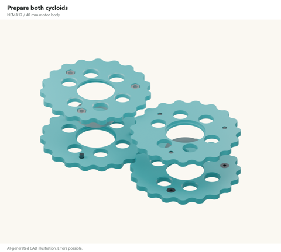](images/discs.png)

### 02. Stand the first layer and screws

Place output_cap_cylinder, carrier_top_cap and yellow shaft_end_upper (E) flanges down. Insert twenty M3 x 30 ring screws, only the three M3 x 35 guide screws, and both M3 x 35 shaft ties from beneath. One shaft tie temporarily occupies E's vacant hex pocket.

**Access check:** Use an open support with at least 50 mm access underneath. Leave the three M3 x 40 guides out.

[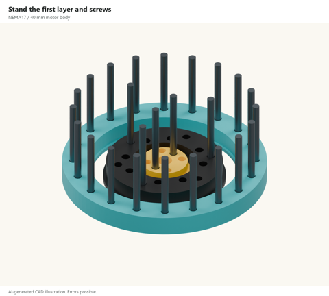](images/start.png)

### 03. Seat the first bearing pair

Lower the first 6810 over the large black inner journal and the first centred 6704 over yellow E. Seat both against their shoulders. Keep these two bearing layers together; neither inner journal is fitted later through a closed bearing.

**Access check:** Both bearings should sit square before the next layer.

[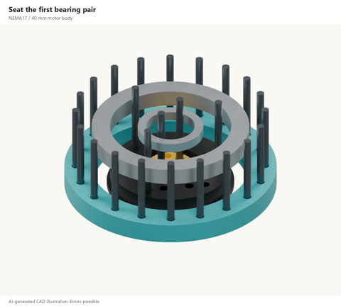](images/bearings_start.png)

### 04. Close the starting inner layer

Load eight M3 nuts into carrier_top and four into shaft_mount_upper (N). Retain them while lowering the pieces with their pockets down. Add the front circular plate, output_circle_plate. The standing screws keep the layers aligned.

**Access check:** The four front-cover screws will use carrier nuts installed here. They cannot be added after this split closes.

[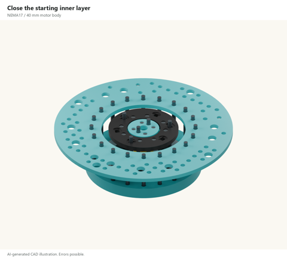](images/inner_start.png)

### 05. Fit the contact and guide sleeves

Fit twenty yellow outer contact sleeves and all six yellow inner guide sleeves, OD 7 x 16 mm. Three inner sleeves have screws through them; locate the other three in their carrier sockets and keep the build upright. Their long screws are fitted after the motor adapter.

**Access check:** Use either the twenty loose outer contacts or one connected contact ring, never both. Keep six separate inner sleeves.

[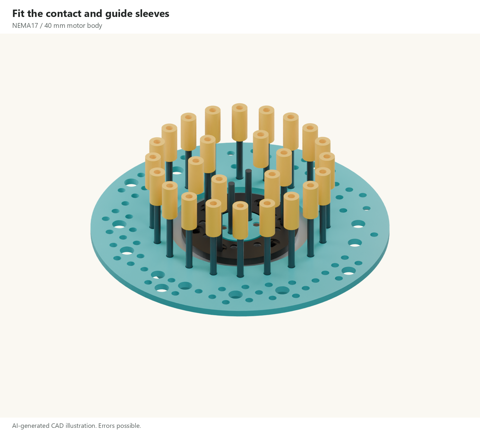](images/sleeves.png)

### 06. Fit cam B and Disc B

Lower shaft_cam_b_outer with its narrow bearing journal up. Lower the closed Disc B over the sleeves and standing screws, screw heads down. Align its indexed clamp screw toward the wide guide gap and seat the bearing on the cam journal.

**Access check:** Rotate gently to find alignment. Do not enlarge the disc tracks or force a misclocked disc over the sleeves.

[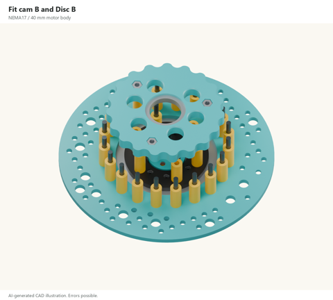](images/disc_b.png)

### 07. Close B and start the opposite cam

Fit shaft_cam_b_inner with its journal down into B's bearing. Then fit shaft_cam_a_inner with its journal up. Keep the two shaft tie holes aligned and place A's eccentric offset 180 degrees opposite B.

**Access check:** The opposed offsets are essential. These are the two centre cam halves, not the outer end halves.

[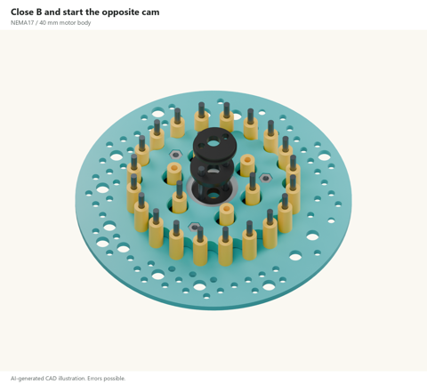](images/cams.png)

### 08. Fit Disc A and close its cam

Lower the closed Disc A with its countersunk heads up. Its indexed clamp screw faces the same wide guide gap used for B. Seat the bearing on A's lower cam half, then fit shaft_cam_a_outer with its journal down.

**Access check:** Keep the bearing seated and the six guide sleeves inside their matching tracks.

[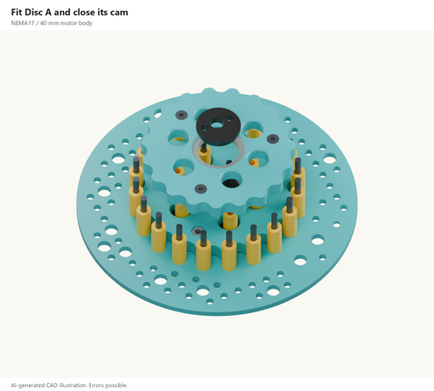](images/disc_a.png)

### 09. Close the motor-side inner layer

Load eight M3 nuts into carrier_bottom and four into the modified shaft_mount_lower (N). Lower these with their pockets up, together with output_circle_rear_plate. Seat all six guide sleeve ends in the carrier sockets.

**Access check:** Use the N piece with the 16 mm coupler bolt circle. Its four nuts must be installed before the next bearing and E cap.

[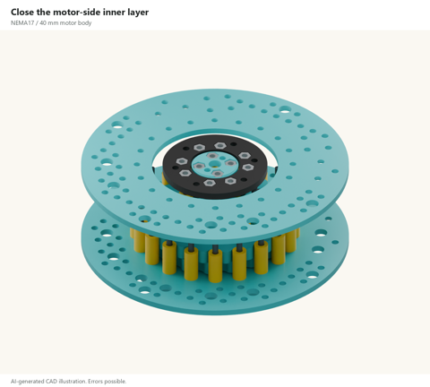](images/inner_finish.png)

### 10. Seat the finishing bearing pair

Lower the second 6810 onto its carrier shoulder and circular-plate layer. Lower the remaining centred 6704 onto the motor-side N journal. Check that both bearings are fully seated and their inner and outer supports are aligned.

**Access check:** This completes two 6810 and four 6704 bearings in the gearbox, including the two disc bearings.

[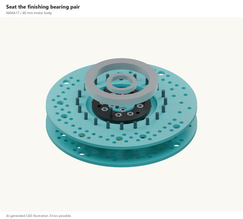](images/bearings_finish.png)

### 11. Fit the finishing caps

Lower output_nut_cylinder, carrier_bottom_cap and the modified yellow shaft_end_lower (E), flanges up. The E piece has four coupler holes on a 16 mm bolt circle. Match its round socket to the temporary tie and its hex pocket to the retained tie.

**Access check:** The 6810 sits entirely in its cylinder. Both bearing rims are captured by the adjoining parts.

[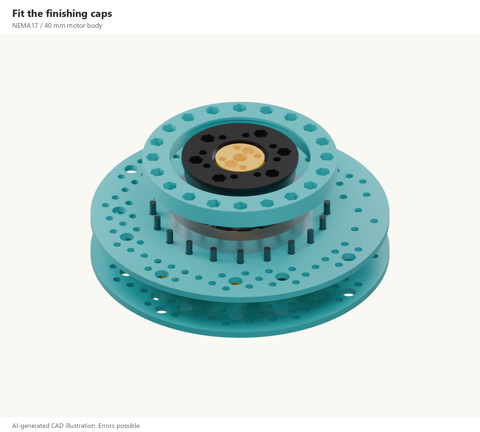](images/caps.png)

### 12. Reverse the temporary shaft tie

Start the twenty ring nuts and the three short-guide nuts. Secure the correctly directed shaft tie. Withdraw the temporary tie downward through the starting face; place an M3 nut in the vacated hex pocket, then reverse that same screw and insert it from the motor side.

**Access check:** Finish with two opposed M3 x 35 shaft ties. Snug ties, three guides and ring screws evenly; check free input motion before adding the coupler.

[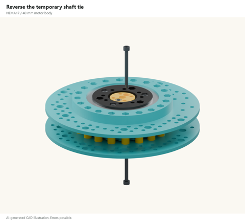](images/reverse.png)

### 13. Attach the flange coupler

Place the 5 mm shaft coupler's wide flange against the modified yellow E face, barrel toward the motor. Fit four M3 x 14 socket caps, each with a 0.5 mm M3 washer, into the four captive nuts in N. Tighten while this face is still open.

**Access check:** Finish both shaft ties first: the coupler covers their tool access. Coupler flange: OD 22 mm, 16 mm screw PCD, 12 mm overall height.

[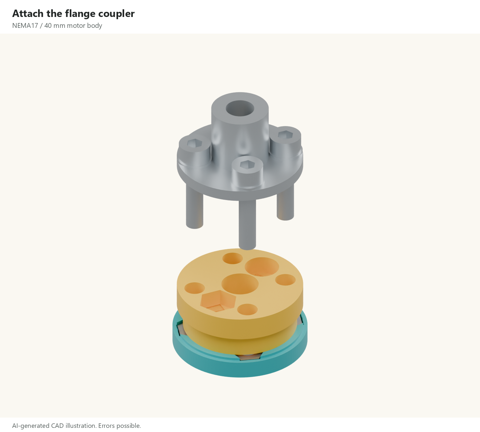](images/coupler.png)

### 14. Bolt the motor to its adapter

On the bench, fasten the 40 mm-body NEMA17 to motor_inner_adapter using four M3 x 8 socket caps. This build uses a 5 mm shaft with 24 mm projection and a 31 mm mounting square. Tighten all four screws before offering it to the gearbox.

**Access check:** The gearbox blocks these screw access bores after installation. The render shows the adapter separated to reveal them.

[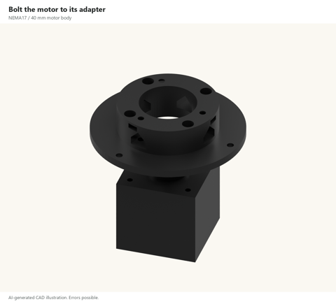](images/motor.png)

### 15. Fit the motor tube on the bench

Load three M3 cage-joining nuts near the tube's gearbox end and three rear-cover nuts near its rear end. Slide the tube over the motor from behind, feeding the cable through the peaked opening. Join it to the adapter with three M3 x 16 socket caps, tightened from the open gearbox-facing side.

**Access check:** Do this before mounting the motor assembly. The tube screws are fully accessible here. Check the cable connector can pass before seating the tube.

[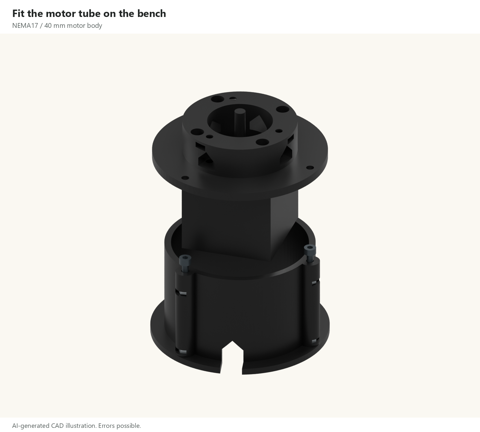](images/tube.png)

### 16. Seat the motor and secure the long guides

Slide the complete motor, adapter and tube onto the coupler. Seat the adapter. Slide its three M3 guide nuts into their radial slots BEFORE inserting the three M3 x 40 guide screws from the front/starting side. Tighten evenly. Align a coupler grub with an adapter window and tighten; rotate the input to reach the other grub.

**Access check:** The tube ends below the grub windows, so both remain reachable. Tighten both supplied grubs before covers and teal joiners.

[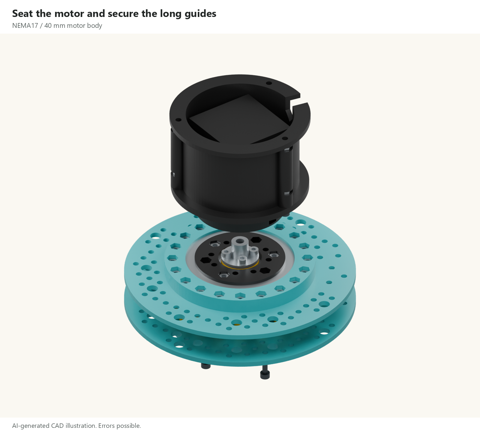](images/mount.png)

### 17. Close the fixed front cover

Fit front_cover_spacer over the front shaft end. Load the chosen captive nuts into front_cover_nuts: up to 15 M6 and 16 M3. Close with front_cover_face and four M3 x 25 countersunk screws into the carrier nuts loaded at step 4.

**Access check:** The shaft ties must already be adjusted. Load mounting nuts before closing the split; keep them out of the shaft clearance.

[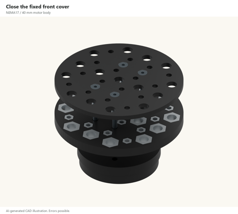](images/front_cover.png)

### 18. Route the cable and close the rear cover

Load rear_cover_nuts with the chosen mounting nuts: up to 19 M6 and 15 M3. Route the motor cable through the fixed tube opening and rear-cover passage, clear of the rotating output. Close with rear_cover_face and three M3 x 16 countersunk screws into the tube's preloaded nuts.

**Access check:** Both black covers stay fixed. The rear black face projects 1.5 mm beyond the teal rear ring.

[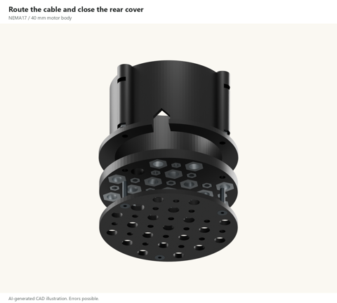](images/rear_cover.png)

### 19. Prepare three identical joiners

Slide four M3 nuts into each teal rear_output_joiner: two near each end, twelve nuts total. Align all hex flats with their slots. The two screw axes are 15 mm apart; each joiner is 78.5 mm tall in the 40 mm-motor build.

**Access check:** All three pieces are identical. Orient their side-loading slots outward when fitted at the three 120-degree stations.

[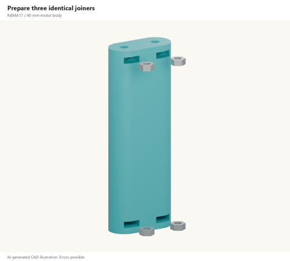](images/joiner_nuts.png)

### 20. Attach the joiners to the gearbox

Bring the three joiners in from the motor/rear side until their ends meet the motor-side circular plate. Pass six M3 x 10 countersunk screws through the access holes in the front plate. Their heads seat in the MOTOR-SIDE plate and engage the joiners' upper nuts.

**Access check:** Use a straight 2 mm hex key through the six 6.4 mm access holes. The front plate is a tool passage, not the screw seat.

[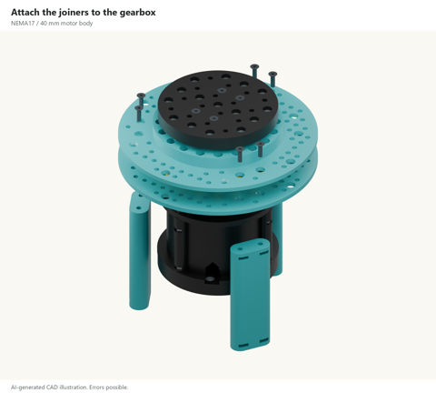](images/joiners.png)

### 21. Attach the separate rear output ring

Bring rear_output_ring (native name rear_output_extension) onto the free ends of the three joiners from behind the motor. Align its six attachment holes. Fit six M3 x 10 countersunk screws from the rear face into the lower joiner nuts.

**Access check:** The flat 3 mm ring and joiners rotate with the gearbox's teal casing. They do not fasten to either black cover.

[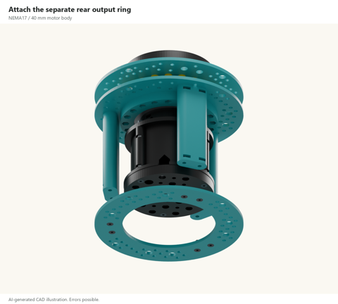](images/rear_ring.png)

### 22. Fit the two extra plate braces

Slide the two yellow rear_output_spacer sleeves radially between the circular plates at the offset brace holes. Load an M3 nut beneath each motor-side hole, then insert an M3 x 25 countersunk screw from the front through each sleeve.

**Access check:** These OD 7 x 16 mm braces have their own screws. They do not replace or share the twelve joiner screws.

[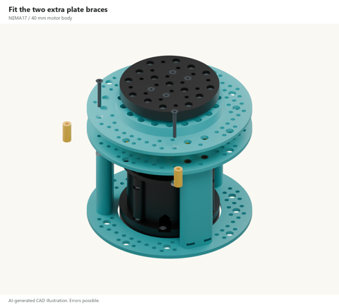](images/braces.png)

### 23. Mount and check the complete gearbox

Attach the stationary frame to the black covers; attach the load to the teal output plates or rear ring. Select external fasteners so they project no more than 2 mm inside either black cover. Keep the cable inside the fixed assembly and clear of all rotating teal parts.

**Access check:** Start slowly with no load and the motor driver set for the motor. Stop and reseat any layer that binds. The fixed-carrier arrangement gives 20:1 output reduction.

[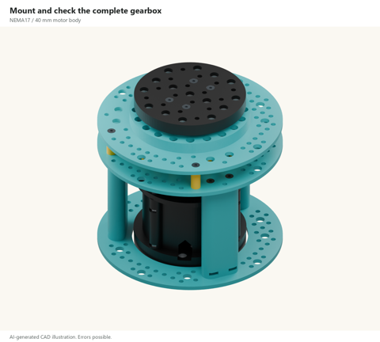](images/finished.png)

## Access details

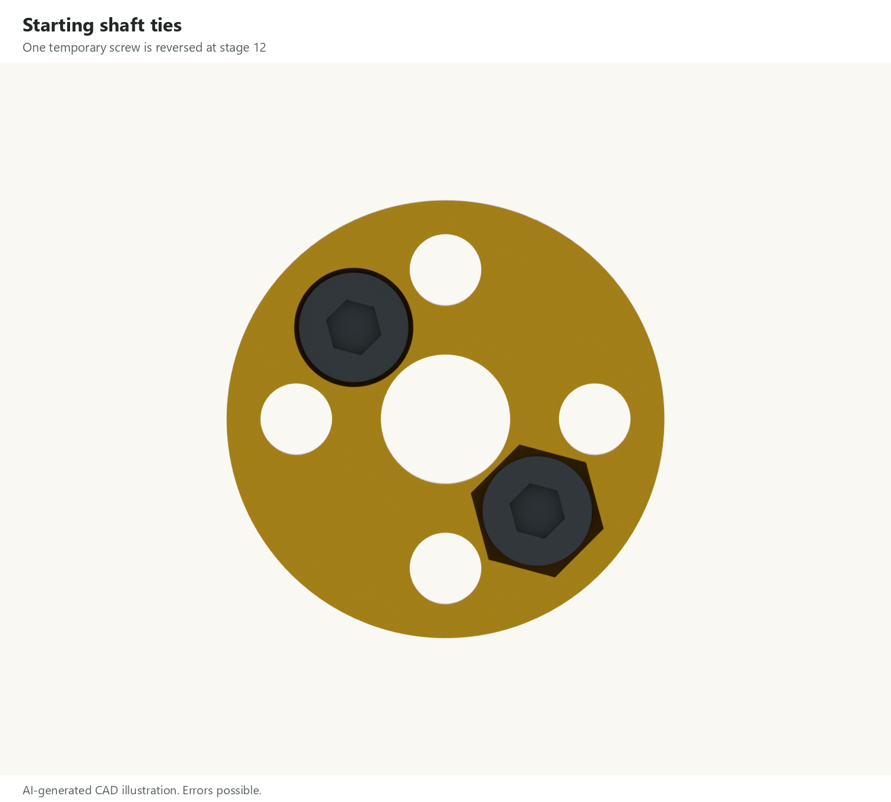

One standing shaft screw begins in a hex nut pocket only as a temporary assembly aid. At stage 12 remove it, load the nut, and reinsert that same screw from the opposite end. Do this before the coupler covers the end.

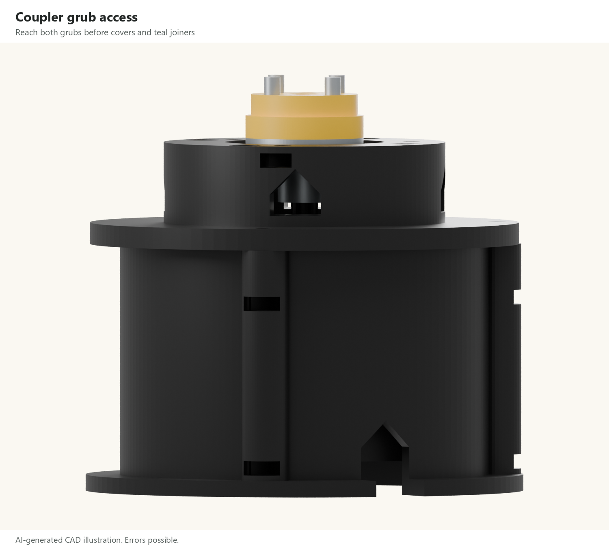

Align the two coupler grubs one at a time with the adapter windows by rotating the input. The bench-built tube remains below the windows. Tighten both before fitting covers and the surrounding teal joiners.

## Verification and limits

Illustrations use the current native STEP/STL geometry. The CAD checks cover the full core insertion sequence, the preassembled motor/tube approach, side-loading the three late guide nuts, and straight 2 mm-diameter grub-tool paths. Existing current-source checks cover cover insertion, joiner nuts, screw seats and the rotating output sweep. See [verification.json](verification.json).

These are geometric checks, not a physical assembly or load test. Cable connectors, print tolerances and the exact purchased coupler still need checking on the bench. Recheck after changing native parameters; this guide is for the recorded 40 mm configuration.

Native source SHA256: `1f6a2f3adafb383be77fbb8b0dc6f1e0d9bcd7b59d9f0c021bd9273bf27b67e5`.
